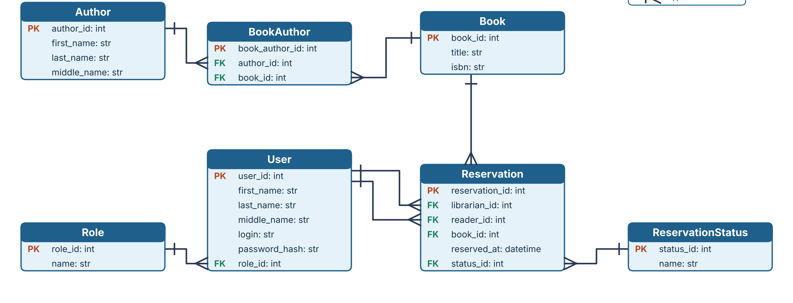

# Library Manager

Library Manager — консольное приложение для управления библиотекой. Программа предназначена для автоматизации процессов работы с произведениями и читателями.
Приложение позволяет регистрировать читателей, выполнять авторизацию и работать с данными библиотеки, включая произведения, авторов и бронирования.

## Возможности программы

* регистрация читателей;
* авторизация пользователей;
* добавление и удаление произведений;
* добавление и удаление авторов;
* связь произведений и авторов (многие-ко-многим);
* бронирование произведений и приём возврата;
* добавление администраторов (библиотекарей);
* хранение данных в базе данных SQLite.

## Структура проекта

```text
LibraryManager/
│
├── .vscode/
│   └── launch.json                  # Конфигурация запуска в VS Code
│
├── docs/                            # Документация проекта
│   ├── usecase.plantuml             # Диаграмма вариантов использования
│   └── diagrams/
│       ├── erd.png                  # ER-диаграмма базы данных
│       └── algorithms.jpg           # Блок-схемы алгоритмов
│
├── src/                             # Исходный код приложения
│   ├── __init__.py
│   └── librarymanager/              # Основной пакет
│       ├── __init__.py
│       ├── main.py                  # Точка входа
│       ├── auth.py                  # Вход и регистрация
│       ├── menu.py                  # Консольные меню
│       ├── database/
│       │   ├── database.py          # Подключение к SQLite
│       │   └── schema.sql           # Создание таблиц и тестовые данные
│       ├── models/                  # Модели предметной области
│       ├── repositories/            # SQL-запросы
│       └── services/                # Бизнес-логика
│
├── tests/                           # Автотесты
├── .gitignore
├── README.md
└── requirements.txt
```

## Архитектура

```text
Пользователь
     │
     ▼
Консольный интерфейс (main.py, menu.py, auth.py)
     │
     ▼
Сервисный слой (services)
     │
     ▼
Слой доступа к данным (repositories)
     │
     ▼
База данных SQLite (database/schema.sql, library.db)
```

## База данных

СУБД — SQLite. Структура и тестовые данные описаны в файле
`src/librarymanager/database/schema.sql`. Файл базы `library.db` создаётся
автоматически в корне проекта при первом запуске (`init_db()`).
Чтобы пересоздать базу, удалите `library.db` и запустите программу снова.

### ER-диаграмма



### Таблицы

| Таблица | Назначение |
|---|---|
| `roles` | Справочник ролей: Reader (1), Librarian (2) |
| `reservation_statuses` | Справочник статусов: Active (1), Returned (2), Canceled (3) |
| `users` | Пользователи (`role_id` → `roles`) |
| `authors` | Авторы |
| `books` | Произведения |
| `book_authors` | Связь «автор — произведение» (M:N) |
| `reservations` | Бронирования (`reader_id`, `librarian_id` → `users`, `book_id` → `books`, `status_id` → `reservation_statuses`) |

Связи: `roles` 1:N `users`; `users` 1:N `reservations` (дважды — читатель и
библиотекарь); `books` 1:N `reservations`; `reservation_statuses` 1:N
`reservations`; `authors` M:N `books` через `book_authors`.

### Тестовые учётные записи

| Роль | Логин | Пароль |
|---|---|---|
| Администратор (библиотекарь) | `admin` | `admin` |
| Читатель | `reader` | `reader` |

Пароли хранятся в виде SHA-256-хэшей. В базу добавлены 6 русскоязычных
авторов, 10 произведений и 3 тестовых бронирования.

## Требования

* Python 3.10 или выше;
* Git.

Внешние библиотеки не нужны (используется только стандартная библиотека).

## Установка и запуск

```bash
git clone https://github.com/zkmshi/LibraryManager.git
cd LibraryManager
python -m venv .venv
```

Активация окружения: Windows PowerShell — `.venv\Scripts\Activate.ps1`,
Linux/macOS — `source .venv/bin/activate`.

Запуск из корневой папки проекта:

```bash
python -m src.librarymanager.main
```

Запуск тестов:

```bash
python -m unittest discover -s tests -t .
```

## Работа в Visual Studio Code

Откройте папку `LibraryManager`, выберите интерпретатор Python из `.venv` и
запустите конфигурацию «LibraryManager: запуск» (F5) — она описана в
`.vscode/launch.json`. Для просмотра `library.db` удобно расширение
**SQLite IntelliView** или программа DB Browser for SQLite.
